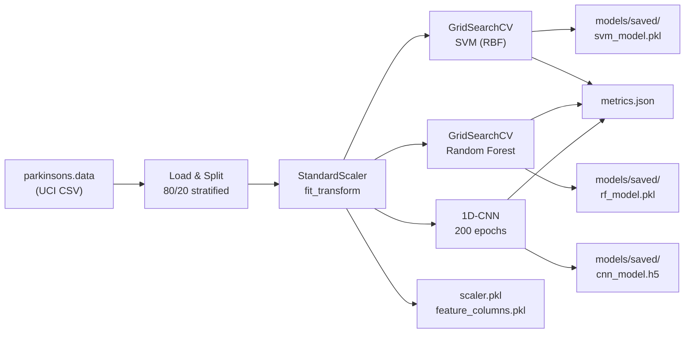
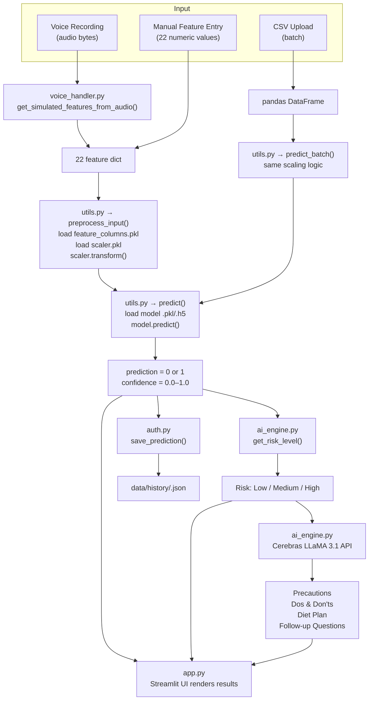

# 🧠 Parkinson's Disease Detection System — End-to-End Documentation

## 1. Project Overview

This is a **Machine Learning–based web application** for early detection of Parkinson's Disease (PD) through speech signal analysis. It combines three ML models (SVM, Random Forest, 1D-CNN) with an AI-powered recommendation engine (Cerebras LLaMA 3.1 8B) to provide diagnosis, risk assessment, and personalized clinical advice — all wrapped in a premium Streamlit dashboard.

---

## 2. Project Architecture & File Map

```
PARKINSON_Project/
│
├── app.py                  ← Main Streamlit UI (797 lines) — all 6 pages
├── auth.py                 ← User authentication & prediction history (SQLite + JSON)
├── ai_engine.py            ← Cerebras LLaMA 3.1 integration for AI recommendations
├── utils.py                ← Model loading, preprocessing, single & batch prediction
├── voice_handler.py        ← Simulated acoustic feature extraction from audio
├── style.css               ← Ultra-premium dark theme (glassmorphism, animations)
├── requirements.txt        ← Python dependencies
│
├── data/
│   ├── parkinsons.data     ← UCI Parkinsons dataset (195 samples, 24 columns)
│   ├── users.db            ← SQLite database for user credentials
│   └── history/            ← Per-user JSON prediction history files
│       └── <username>.json
│
└── models/
    ├── train_models.py     ← Training pipeline (SVM, RF, CNN with GridSearchCV)
    └── saved/
        ├── svm_model.pkl       ← Trained SVM model
        ├── rf_model.pkl        ← Trained Random Forest model
        ├── cnn_model.h5        ← Trained 1D-CNN model (Keras)
        ├── scaler.pkl          ← Fitted StandardScaler
        ├── feature_columns.pkl ← List of 22 feature names
        └── metrics.json        ← Accuracy, F1, confusion matrices, ROC data
```

---

## 3. End-to-End Data Flow

The system has **two distinct data pipelines** — a one-time **Training Pipeline** and a runtime **Prediction Pipeline**.

### 3.1 Training Pipeline (offline, run once)

> **Entry point:** `python models/train_models.py`



**Step-by-step:**

| Step | What Happens | File | Key Detail |
|------|-------------|------|------------|
| 1 | Load CSV | `train_models.py:36` | Reads `data/parkinsons.data` (195 samples, 22 features + `name` + `status`) |
| 2 | Extract features | `train_models.py:41-43` | Drops `name` and `status` columns → 22 biomedical speech features become X; `status` (0=Healthy, 1=PD) becomes y |
| 3 | Train/Test split | `train_models.py:49-51` | 80/20 split with `stratify=y` and `random_state=42` |
| 4 | Scale features | `train_models.py:55-58` | `StandardScaler().fit_transform(X_train)` → saves `scaler.pkl` |
| 5 | Train SVM | `train_models.py:103-123` | `GridSearchCV` over C=[0.1..1000], gamma=[scale,auto,0.01..], RBF kernel, 5-fold stratified CV |
| 6 | Train Random Forest | `train_models.py:125-152` | `GridSearchCV` over n_estimators=[200,500,800], max_depth, min_samples_split/leaf, max_features; also saves `feature_importance` |
| 7 | Train 1D-CNN | `train_models.py:154-238` | 3×Conv1D (64→128→256 filters) + BatchNorm + GlobalAvgPooling + Dense(128→64→32→1 sigmoid); Adam optimizer, EarlyStopping(patience=20), ReduceLROnPlateau |
| 8 | Save everything | `train_models.py:248-268` | `svm_model.pkl`, `rf_model.pkl`, `cnn_model.h5`, `scaler.pkl`, `feature_columns.pkl`, `metrics.json` |

**22 Speech Features used:**

| Category | Features |
|----------|----------|
| Fundamental Frequency | `MDVP:Fo(Hz)`, `MDVP:Fhi(Hz)`, `MDVP:Flo(Hz)` |
| Jitter (frequency perturbation) | `MDVP:Jitter(%)`, `MDVP:Jitter(Abs)`, `MDVP:RAP`, `MDVP:PPQ`, `Jitter:DDP` |
| Shimmer (amplitude perturbation) | `MDVP:Shimmer`, `MDVP:Shimmer(dB)`, `Shimmer:APQ3`, `Shimmer:APQ5`, `MDVP:APQ`, `Shimmer:DDA` |
| Noise | `NHR` (Noise-to-Harmonics), `HNR` (Harmonics-to-Noise) |
| Nonlinear Dynamics | `RPDE`, `DFA`, `spread1`, `spread2`, `D2`, `PPE` |

---

### 3.2 Prediction Pipeline (runtime, every user request)

> **Entry point:** `streamlit run app.py`



**Step-by-step for a single prediction:**

| Step | Code Location | What Happens |
|------|--------------|--------------|
| 1. **User inputs data** | `app.py:578-596` (manual) or `app.py:362-371` (voice) or `app.py:666-670` (CSV) | User provides the 22 speech features via one of three input methods |
| 2. **Voice → Features** | `voice_handler.py:10-46` | If voice input: audio bytes are MD5-hashed → deterministic seed → 22 simulated features generated via `np.random.uniform()` within clinically plausible ranges |
| 3. **Preprocessing** | `utils.py:49-59` | `preprocess_input()` loads `feature_columns.pkl` + `scaler.pkl` → constructs numpy array in correct column order → `scaler.transform()` to standardize |
| 4. **Model Prediction** | `utils.py:62-84` | `predict()` loads the selected model → For SVM/RF: `model.predict()` + `model.predict_proba()` → For CNN: reshape to (1, 22, 1) + `model.predict()` → returns `(prediction, confidence)` |
| 5. **Risk Assessment** | `ai_engine.py:19-26` | `get_risk_level(prediction, confidence)` → If prediction=0: "Low", if confidence≥0.85: "High", else: "Medium" |
| 6. **AI Recommendations** | `ai_engine.py:47-65` | 4 separate Cerebras LLaMA 3.1 API calls generate: precautions, dos/don'ts, diet plan, follow-up questions — each tailored to the risk level |
| 7. **Save to History** | `auth.py:66-79` | `save_prediction()` appends result (timestamp, model, diagnosis, confidence, risk, features) to `data/history/<username>.json` |
| 8. **Render UI** | `app.py:410-433` | Streamlit displays: result card (Healthy/PD), AI recommendations in 3 columns, expandable follow-up questions, interactive AI chatbot |

---

## 4. Module-by-Module Deep Dive

### 4.1 `app.py` — Main Application (Streamlit UI)

The central file that orchestrates everything. It defines **6 pages** accessible via sidebar navigation:

| Page | Lines | Purpose |
|------|-------|---------|
| 🔐 Login / Register | 178–223 | User authentication forms (login/register tabs) |
| 🏠 Home | 438–538 | Landing page with metrics, "How It Works", tech stack badges, dataset overview |
| 📊 Dashboard | 228–320 | User's prediction history table, risk distribution pie chart, AI-generated history trend summary |
| 🎤 Voice Recorder | 325–433 | Record/upload audio → feature extraction → prediction → AI recommendations |
| 🔬 Predict | 543–709 | Manual 22-feature input OR CSV batch upload → prediction → AI recommendations |
| 📈 Model Analytics | 714–764 | Bar chart comparing model accuracies, confusion matrices for all 3 models |
| 📖 About | 769–797 | Project abstract, dataset info table |

**Key UI Features:**
- Session state management (`st.session_state`) for login persistence, model selection, and prediction results
- `display_ai_recommendations()` helper (lines 93–173) — reusable function rendering risk badges, 3-column advice cards, and an interactive AI chatbot
- The AI chatbot (lines 147–172) uses `ai_engine._call_llama()` with a custom system prompt incorporating the patient's risk level

---

### 4.2 `auth.py` — Authentication & History

**Storage architecture:**
- **Users** → SQLite database at `data/users.db` with table `users(id, username, password_hash, full_name, created_at)`
- **Passwords** → SHA-256 hashed via `hashlib.sha256()`
- **Prediction History** → JSON files at `data/history/<username>.json` (one file per user)

| Function | Purpose |
|----------|---------|
| `register(username, password, full_name)` | Inserts new user, returns error on duplicate username |
| `login(username, password)` | Validates credentials, returns user info dict `{id, username, full_name}` |
| `save_prediction(username, data)` | Appends prediction record with auto-generated timestamp and ID to user's JSON file |
| `get_history(username)` | Returns full prediction history list |
| `get_history_stats(username)` | Computes aggregate stats: total, healthy, parkinsons, high/medium/low risk counts, avg confidence |

---

### 4.3 `ai_engine.py` — Cerebras LLaMA 3.1 Integration

Uses the **Cerebras Cloud SDK** to call the `llama3.1-8b` model for generating personalized medical advice.

| Function | Prompt Summary | Use Case |
|----------|---------------|----------|
| `get_risk_level(prediction, confidence)` | Pure logic, no API call | Converts (prediction, confidence) → "Low"/"Medium"/"High" |
| `get_precautions(risk_level)` | "List 4-5 immediate clinical precautions for {risk} risk PD" | Precaution card |
| `get_dos_donts(risk_level)` | "3 Dos and 3 Don'ts for daily life" | Dos/Don'ts card |
| `get_diet_plan(risk_level)` | "Evidence-based dietary plan, under 100 words" | Diet card |
| `get_follow_up_questions(risk_level)` | "3 essential follow-up questions for neurologist" | Expandable section |
| `generate_dashboard_summary(history)` | Analyzes last 5 predictions, produces 2-sentence trend | Dashboard page |
| `_call_llama(prompt, system_prompt)` | Core API call wrapper | Used by all above + chatbot |

**API Configuration:** `model="llama3.1-8b"`, `temperature=0.7`, `max_tokens=500`

---

### 4.4 `utils.py` — Model Loading & Prediction Engine

The bridge between the trained models (on disk) and the Streamlit app.

| Function | What It Does |
|----------|-------------|
| `load_model(name)` | Loads SVM/RF via `joblib.load()` or CNN via `keras.load_model()` |
| `load_scaler()` | Returns the fitted `StandardScaler` from `scaler.pkl` |
| `load_feature_columns()` | Returns the ordered list of 22 feature names from `feature_columns.pkl` |
| `load_metrics()` | Returns model performance metrics from `metrics.json` |
| `preprocess_input(features_dict)` | Converts feature dict → ordered numpy array → `scaler.transform()` → scaled array |
| `predict(model_name, features_dict)` | Single prediction: preprocess → model.predict → returns `(prediction, confidence)` |
| `predict_batch(model_name, df)` | Batch prediction on DataFrame: validates columns → scale → predict → returns DataFrame with Diagnosis + Confidence columns |
| `get_dataset_info()` | Loads and describes the raw training CSV for sample downloads |
| `FEATURE_INFO` dict | Feature metadata (description, min, max, default) for UI input fields |

**CNN prediction detail:** Input is reshaped to `(1, 22, 1)` for Conv1D → `model.predict()` returns sigmoid probability → threshold at 0.5.

---

### 4.5 `voice_handler.py` — Audio Feature Extraction

> ⚠️ **Simulated module** — In production, this would use Praat/Parselmouth for real acoustic analysis.

**How it works:**
1. Takes raw audio bytes as input
2. Computes `MD5 hash` of the audio → converts first 8 hex chars to int for a deterministic seed
3. Uses `np.random.seed(audio_hash)` + `np.random.uniform()` to generate 22 features within clinically plausible ranges
4. Returns a dictionary matching the exact 22 feature names expected by the models

This ensures the **same audio always produces the same features** (deterministic) while different audio produces different features.

---

### 4.6 `models/train_models.py` — Training Pipeline

Self-contained script that trains all three models from scratch:

| Model | Algorithm | Hyperparameter Search | Key Config |
|-------|-----------|----------------------|------------|
| **SVM** | Support Vector Classifier (RBF) | GridSearchCV: C=[0.1,1,10,100,1000] × gamma=[scale,auto,0.01,0.001,0.0001] | `probability=True`, 5-fold stratified CV |
| **Random Forest** | Ensemble of decision trees | GridSearchCV: n_estimators=[200,500,800] × max_depth=[5,10,15,20,None] × min_samples=[2,5,10] × leaf=[1,2,4] × max_features=[sqrt,log2] | `n_jobs=-1` parallel training |
| **1D-CNN** | Deep Conv Neural Network | No GridSearch; uses callbacks | Conv1D(64→128→256) + BatchNorm + Dense(128→64→32→1), EarlyStopping(patience=20), ReduceLROnPlateau |

**Evaluation metrics saved for each model:** accuracy, precision, recall, F1, ROC AUC, confusion matrix, FPR/TPR arrays.

---

### 4.7 `style.css` — Premium Dark Theme

A 410-line CSS file implementing:
- **Glassmorphism** effects (`backdrop-filter: blur(24px)`, semi-transparent backgrounds)
- **Custom color palette** with CSS variables (`--accent-blue`, `--accent-indigo`, etc.)
- **Google Fonts**: Outfit (headings) + Inter (body)
- **Animations**: `fadeInUp`, `scaleIn`, `float` keyframes
- **Styled Streamlit components**: inputs, buttons, sidebar, scrollbar, dataframes

---

## 5. Data Sources & Storage Summary

| Data | Location | Format | Created By |
|------|----------|--------|------------|
| Training dataset | `data/parkinsons.data` | CSV (195 rows × 24 cols) | UCI ML Repository (pre-existing) |
| User credentials | `data/users.db` | SQLite | `auth.py` at registration |
| Prediction history | `data/history/<user>.json` | JSON array | `auth.py` at each prediction |
| Trained SVM model | `models/saved/svm_model.pkl` | Joblib pickle | `train_models.py` |
| Trained RF model | `models/saved/rf_model.pkl` | Joblib pickle | `train_models.py` |
| Trained CNN model | `models/saved/cnn_model.h5` | Keras HDF5 | `train_models.py` |
| Feature scaler | `models/saved/scaler.pkl` | Joblib pickle | `train_models.py` |
| Feature names | `models/saved/feature_columns.pkl` | Joblib pickle | `train_models.py` |
| Performance metrics | `models/saved/metrics.json` | JSON | `train_models.py` |

---

## 6. Technology Stack

| Layer | Technology | Purpose |
|-------|-----------|---------|
| Frontend | Streamlit + Custom CSS | Web dashboard UI |
| ML Models | Scikit-learn (SVM, RF) + TensorFlow/Keras (CNN) | Disease classification |
| AI Engine | Cerebras Cloud SDK → LLaMA 3.1 8B | Clinical recommendations & chatbot |
| Data Processing | Pandas, NumPy | Feature manipulation & preprocessing |
| Visualization | Plotly (px + go) | Charts, confusion matrices, pie charts |
| Authentication | SQLite + hashlib SHA-256 | User management |
| History Storage | JSON files | Per-user prediction records |
| Model Persistence | Joblib + Keras save | Serialized trained models |
| Voice Input | audio_recorder_streamlit | Browser audio recording |

---

## 7. How to Run

```bash
# 1. Install dependencies
pip install -r requirements.txt

# 2. Train models (one-time)
python models/train_models.py

# 3. Launch the app
streamlit run app.py
```

The app will open at `http://localhost:8501`. Register a new account, then explore all pages.

---

## 8. Complete Request-Response Lifecycle Example

**Scenario:** User records voice → gets PD prediction + AI advice

1. **User** clicks "Record Voice" on the 🎤 Voice Recorder page → browser captures audio → `audio_bytes` sent to server
2. **`voice_handler.py`** → `get_simulated_features_from_audio(audio_bytes)` → generates 22 features deterministically from audio hash
3. **`utils.py`** → `preprocess_input(features)` → loads `scaler.pkl` → `scaler.transform()` → normalized 22-dim array
4. **`utils.py`** → `predict("Random Forest", features)` → loads `rf_model.pkl` → `model.predict()` → returns `(1, 0.92)` (PD detected, 92% confidence)
5. **`ai_engine.py`** → `get_risk_level(1, 0.92)` → returns `"High"` (prediction=1 and confidence≥0.85)
6. **`ai_engine.py`** → 4 Cerebras API calls with risk="High":
   - `get_precautions("High")` → "Seek immediate neurological evaluation..."
   - `get_dos_donts("High")` → "Do: exercise regularly... Don't: ignore tremors..."
   - `get_diet_plan("High")` → "Include omega-3 rich foods..."
   - `get_follow_up_questions("High")` → "Ask your doctor about DaTscan..."
7. **`auth.py`** → `save_prediction("john", {...})` → appends to `data/history/john.json`
8. **`app.py`** → Renders: ⚠️ PD Detected card (92% confidence) + 3 advice columns + expandable Q&A + AI chatbot

---

*Document generated on 2026-04-06. Built with ❤️ by Batch 14.*
